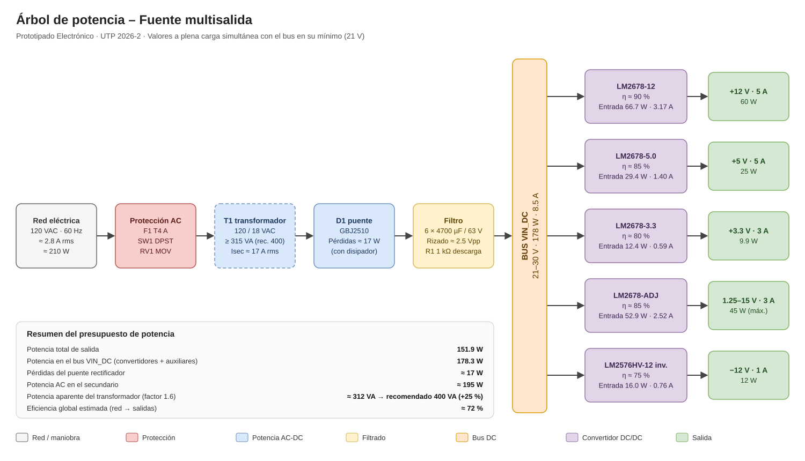

# 06 – Árbol de Potencia

El árbol de potencia muestra cómo se distribuye la energía desde la red eléctrica hasta cada riel de salida, con la potencia, la corriente y la eficiencia de cada etapa. Con él se dimensionan el transformador, el puente rectificador, el bus DC y las protecciones.

Archivo editable: [`Diagramas/Arbol_Potencia.drawio`](Diagramas/Arbol_Potencia.drawio?raw=true) (abrir en [app.diagrams.net](https://app.diagrams.net)).

## 1. Supuestos de cálculo

| Supuesto | Valor | Justificación |
|---|---|---|
| Condición de carga | Todas las salidas a corriente máxima al mismo tiempo | Peor caso de diseño |
| Tensión del bus VIN_DC | 21 V (mínimo) | Valle del rizado con red al −10 % y carga plena |
| Salida variable | 15 V × 3 A = 45 W | Punto de máxima potencia de esa salida |
| η LM2678-12 | 90 % | Datasheet: 92 % típico (Vin = 24 V, 5 A) |
| η LM2678-5.0 | 85 % | Datasheet: 84 % típico (Vin = 12 V, 5 A); con Vin mayor se asume similar |
| η LM2678-3.3 | 80 % | Datasheet: 82 % típico (Vin = 12 V, 5 A), con margen |
| η LM2678-ADJ | 85 % | Estimado para 15 V de salida |
| η LM2576HV-12 inversor | 75 % | Estimado: topología buck-boost con switch bipolar (Vsat ≈ 1.4 V) |
| Caída por diodo del puente | ≈ 1 V | Conducen 2 diodos en serie por semiciclo |
| Factor de potencia aparente del transformador | 1.6 | Rectificador de onda completa con filtro capacitivo |
| Eficiencia del transformador | ≈ 93 % | Valor típico para 300–400 VA |

## 2. Presupuesto de potencia por riel

| Riel | Convertidor | V | I máx. | P salida | η | P entrada (bus) | I desde el bus (21 V) | Pérdidas |
|---|---|---|---|---|---|---|---|---|
| +12 V | LM2678-12 | 12 V | 5 A | 60.0 W | 90 % | 66.7 W | 3.17 A | 6.7 W |
| +5 V | LM2678-5.0 | 5 V | 5 A | 25.0 W | 85 % | 29.4 W | 1.40 A | 4.4 W |
| +3.3 V | LM2678-3.3 | 3.3 V | 3 A | 9.9 W | 80 % | 12.4 W | 0.59 A | 2.5 W |
| Variable | LM2678-ADJ | 1.25–15 V | 3 A | 45.0 W | 85 % | 52.9 W | 2.52 A | 7.9 W |
| −12 V | LM2576HV-12 (inversor) | −12 V | 1 A | 12.0 W | 75 % | 16.0 W | 0.76 A | 4.0 W |
| Auxiliares | R1 descarga, LEDs | — | — | — | — | ≈ 0.9 W | 0.04 A | 0.9 W |
| **Total** | | | | **151.9 W** | | **178.3 W** | **8.49 A** | **26.4 W** |

## 3. Etapa de entrada

| Etapa | Magnitud | Cálculo | Valor |
|---|---|---|---|
| Bus VIN_DC | Corriente media | 178.3 W / 21 V | **8.5 A** |
| Puente D1 (GBJ2510) | Pérdidas | 2 × 1 V × 8.5 A | **≈ 17 W** |
| Secundario T1 | Potencia activa | 178.3 W + 17 W | **≈ 195 W** |
| Secundario T1 | Potencia aparente | 1.6 × 195 W | **≈ 312 VA** |
| Secundario T1 | Corriente RMS | 312 VA / 18 V | **≈ 17.4 A** |
| Condensadores C1–C6 | Corriente de rizado RMS | √(17.4² − 8.5²) | **≈ 15.2 A** |
| Primario T1 | Corriente RMS | 312 VA / 0.93 / 120 V | **≈ 2.8 A** |
| Red | Potencia consumida | 195 W / 0.93 | **≈ 210 W** |

Eficiencia global estimada (red → salidas): 151.9 W / 210 W ≈ **72 %**.

## 4. Márgenes de diseño (20–30 %)

| Elemento | Requerido | Con margen (+25 %) | Capacidad del componente | Estado |
|---|---|---|---|---|
| U1 +12 V | 5 A | 6.25 A | LM2678: 5 A nominal (límite 5.75–8.75 A) | ⚠ Sin margen nominal. Riesgo documentado; alternativa LM5116 |
| U2 +5 V | 5 A | 6.25 A | LM2678: 5 A nominal | ⚠ Igual que +12 V |
| U3 +3.3 V | 3 A | 3.75 A | LM2678: 5 A | ✓ 67 % de margen |
| U4 variable | 3 A | 3.75 A | LM2678: 5 A | ✓ 67 % de margen |
| U5 −12 V | 1 A | 1.25 A | Pico en el switch 2.70 A vs. límite mínimo 3.5 A | ✓ 30 % de margen. ⚠ TI documenta ~0.7 A con Vin = 12 V; verificar 1 A en banco |
| Puente D1 | 8.5 A | 10.6 A | GBJ2510: 25 A | ✓ |
| Bornera J3 (secundario) | 17.4 A rms | 21.7 A | Phoenix MKDS 3: 24 A | ✓ |
| Condensadores C1–C6 | 15.2 A rms | 19 A | 6 × 2.51 A = 15.1 A (a 105 °C) | ⚠ Al límite a 105 °C; a la temperatura real de operación el fabricante admite más corriente (factor de temperatura). Verificar temperatura de los condensadores |
| Transformador T1 | 312 VA | 390 VA | Transformador del laboratorio | ⚠ Mínimo 315 VA; recomendado 400 VA |
| Fusible F1 (primario) | 2.8 A | — | T4 A | ✓ |

## 5. Disipación térmica

| Etapa | Pérdidas estimadas | Medida |
|---|---|---|
| Puente D1 | ≈ 17 W | Disipador obligatorio; es la mayor fuente de calor de la fuente |
| Convertidor +12 V | ≈ 6.7 W | Disipador para U1 y D1 (MBRF1045 aislado) |
| Convertidor variable | ≈ 7.9 W | Disipador para U4 y su diodo |
| Convertidor +5 V | ≈ 4.4 W | Disipador |
| Convertidor −12 V | ≈ 4.0 W | Cobre de la PCB en el net −12 V (pestaña a −12 V, sin contacto con otros disipadores) |
| Convertidor +3.3 V | ≈ 2.5 W | Disipador pequeño |
| Total desde la red | ≈ 58 W | Se requiere caja con ventilación (RD-15) |

## 6. Cambios respecto a la documentación inicial

El árbol de potencia incluye las pérdidas del puente rectificador, que no estaban en el cálculo preliminar. Esto modifica tres valores:

| Parámetro | Valor inicial | Valor actualizado | Motivo |
|---|---|---|---|
| Potencia del transformador | ≥ 300 VA | **≥ 315 VA, recomendado 400 VA** | Pérdidas del puente (~17 W) y margen del 25 % |
| Fusible del primario | T3.15 A | **T4 A** | Corriente de primario ≈ 2.8 A (89 % de 3.15 A) |
| Disipación del puente | No especificada | **Disipador obligatorio** | ≈ 17 W de pérdidas |

## 7. Fórmulas utilizadas

- Potencia de entrada de cada convertidor: P_in = P_out / η
- Corriente desde el bus: I_in = P_in / V_bus,mín
- Pérdidas del puente: P_D1 = 2 · V_F · I_bus
- Potencia aparente del transformador: S ≈ 1.6 · P_AC
- Corriente de rizado en los condensadores: I_C,rms = √(I_sec,rms² − I_bus²)
